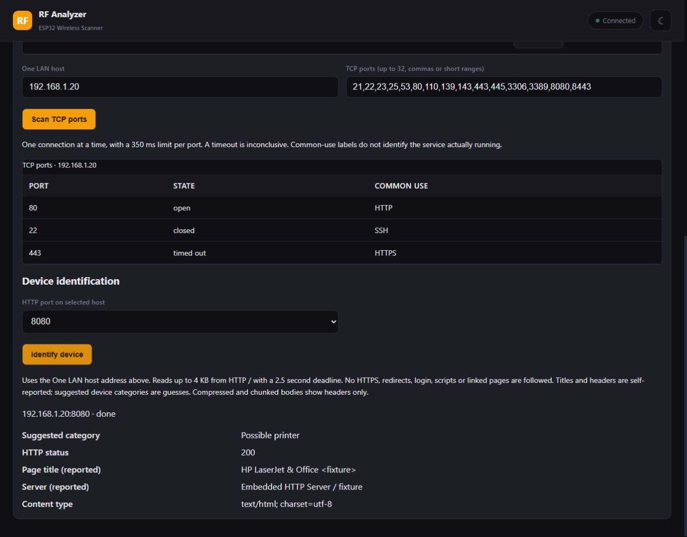
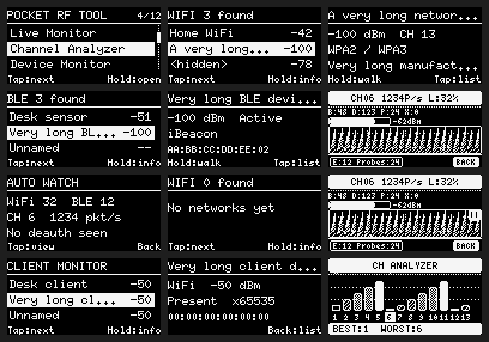
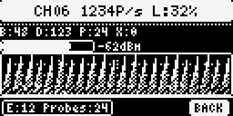

# ESP32 Pocket RF Tool

WiFi and BLE scanner, security monitor, and RF diagnostics tool for ESP32.


## Current version: v2.3.0

- Probe-request history, EAPOL activity detection and bounded RAM PCAP export.
- Local network discovery, TCP port scanning and HTTP device identification.
- Clearer three-row OLED menus and device lists, with the original Live Monitor layout preserved.

Existing checked-in release binaries have not been regenerated for v2.3.0; build from the current source to use these features.

ESP32-C3 is the primary compiled target. The latest firmware and SPIFFS web image were uploaded to a 4 MB ESP32-C3 and verified by the flashing tool. Physical OLED operation and real-network feature validation remain pending; see [PLAN.md](PLAN.md) for the exact checks and limits.

## Screenshots

These previews use **synthetic test data**. The web image is a browser screenshot; the OLED images are **128×64 U8g2 renders from the production drawing functions**, enlarged for readability, rather than photographs of a device.

### Web UI — LAN scanner and device identification

Select a discovered host and read its reported HTTP title, server header and response status. Suggested device categories are tentative clues.



### OLED — menus, scanning and monitoring

Three-row menus, WiFi/BLE/client lists, detail views, Auto Watch and channel analysis. The original Live Monitor page remains intact.



### OLED — original Live Monitor

Channel, packet rate, load, packet-type counters, RSSI bar, patterned history graph and EAPOL/probe footer.



## v2.1.0: Probe history, EAPOL, and PCAP

Open **Analyzer → Probe History & EAPOL** in the web interface:

1. **Start listening** records probe requests and EAPOL activity on the web access point's channel. The existing OLED Live Monitor and client monitor also collect history while listening.
2. **New PCAP** starts a fresh raw capture. **Stop PCAP** keeps its packets while continuing history and EAPOL monitoring.
3. **Download PCAP** stops raw recording and downloads `esp32-capture.pcap`. Open it in Wireshark; the Radiotap records include channel frequency and RSSI. The existing packet-log CSV export remains available separately.
4. **Clear history & PCAP** clears probe history, EAPOL counts, and saved raw packets. It also clears the older probed-name list.

Probe history keeps 24 `(source MAC, SSID)` entries, including wildcard probes, with count, latest RSSI/channel, and first/last device-uptime timestamps. The least recently seen entry is replaced at capacity; the eviction count is shown. EAPOL counts are shown overall and per channel; encrypted, fragmented, aggregated A-MSDU, malformed, and incomplete frames are not misread as plain EAPOL. EAPOL activity alone does not establish that a complete handshake was captured. EAPOL packets are labeled in the packet log, and the OLED Live Monitor footer shows EAPOL/history totals.

PCAP storage is RAM-only: the first 32 packets, up to 768 raw 802.11 bytes each (783-byte snap length including Radiotap). Further packets increment the buffer-drop counter; oversized frames retain their original length and increment the truncation counter. These counters do not measure hardware losses or packets missed during Wi-Fi scans. Timestamps use 64-bit uptime, not wall-clock UTC. The hardware FCS is removed and Radiotap marks it absent. Restarting loses all history and captures. No SD card, flash writes, active probes, or deauthentication transmissions are added.

Capture API: `GET /api/capture` (status/history), `GET /api/capture.pcap` (binary download), and POST actions `start_sniffer`, `stop_capture`, `start_pcap`, `stop_pcap`, `clear_capture` through `/api/action?type=...`. Starting PCAP replaces only the raw packet buffer; starting listening preserves probe/EAPOL history.

The M5 reference and its license are documented in [THIRD_PARTY.md](THIRD_PARTY.md). Run `./scripts/test-capture.ps1` with Node.js and a complete Zig installation to execute the production C++ capture engine as WebAssembly, validate the PCAP format with an independent decoder, and run browser regressions. `node tests/preview-capture.cjs` serves a synthetic local UI fixture; it does not access a radio.

## Stabilization work

See [PLAN.md](PLAN.md) for the bug audit, validation status, hardware checks, and proposed M5-inspired additions. [AGENTS.md](AGENTS.md) describes repository conventions.

This working version validates packet lengths and settings, escapes radio-derived text, uses asynchronous BLE scanning, and keeps web capture on the access point's channel so the browser stays connected. Use the OLED Live Monitor to monitor other channels. The web interface reports the channel actually being captured.

Security indicators are investigative hints: an AP warning means matching non-empty SSIDs with different authentication modes, and BLE Review lists unnamed devices or recognized beacon advertisements. These do not prove an evil twin or personal tracking. Probed network names do not prove a network is hidden. ESP32-S2 supports the Wi-Fi tools only; it has no BLE radio.

For a Windows firmware build, run `./scripts/build.ps1` from PowerShell with Arduino CLI, the ESP32 core, U8g2, and Adafruit NeoPixel installed. The script stages source files, saves new firmware under `build/c3`, and never flashes a device. Supply `-ArduinoCli` or `-ConfigFile` if your tools use custom locations. An optional `-ZigExe` selects LLVM's archive tool; it does not change Windows security settings. The verified dependency versions and exact checks are recorded in PLAN.md.

Run browser regressions with `node tests/web-regressions.cjs`. The compile-time packet/JSON regressions can be checked with the ESP32 toolchain's `riscv32-esp-elf-g++ -std=c++17 -fsyntax-only tests/firmware-regressions.cpp`.


## Features

### Scanning & Discovery
- **WiFi AP Scanner** — detect nearby access points with SSID, BSSID, channel, RSSI, security type (Open/WEP/WPA/WPA2/WPA3), estimated distance, and signal quality grade (A-F)
- **BLE Scanner** — discover Bluetooth Low Energy devices with name, address, RSSI, manufacturer ID, and advertisement type
- **Client Monitor** — passive WiFi client detection via promiscuous mode sniffing (probe requests, association frames, data frames) with channel hopping
- **Device Tracking** — track up to 15 WiFi clients and BLE devices over time with first/last seen timestamps, presence status, and visit count

### Identification
- **WiFi Vendor Lookup** — resolves device manufacturer from MAC address using a 600+ entry OUI database stored on SPIFFS (Apple, Samsung, Google, Intel, Cisco, Huawei, Xiaomi, TP-Link, and more)
- **BLE Vendor Lookup** — identifies BLE devices by manufacturer company ID extracted from advertisement data, with a 200+ entry database covering PC/laptop brands (Intel, Dell, Lenovo, ASUS, Acer, MSI, AMD, HP), mobile (Apple, Samsung, Google, Xiaomi), peripherals (Logitech, Bose, JBL, Jabra, Razer, Corsair), and IoT (Espressif, Nordic, Tile, Ruuvi)
- **Hardcoded Fallback** — built-in vendor table used automatically if SPIFFS is unavailable

### Analysis & Diagnostics
- **Channel Analyzer** — per-channel traffic breakdown across all 13 channels with beacon, data, and probe packet counts, overlap detection, and best channel recommendation
- **Live Monitor** — real-time packet capture showing packets per second, smoothed PPS, average RSSI, and frame type breakdown (Beacon/Data/Probe/Deauth)
- **RF Health Scoring** — environment health assessment with congestion percentage, quality rating (Good/OK/Busy/Avoid), and actionable insights with RSSI trend graph
- **Walk Tests** — RSSI signal strength tracking over time for both WiFi APs and BLE devices, with live graph, min/max/avg stats, and toggleable views
- **Why Is It Slow?** — automated WiFi performance diagnostics analyzing congestion, AP count, and signal quality with per-AP RSSI graphs
- **Channel Recommendation** — finds the least congested non-overlapping channel (1, 6, 11)
- **Environment Baseline** — snapshot and compare RF environment changes over time

### Security
- **Deauth Detection** — real-time monitoring of deauthentication and disassociation attacks with configurable alert thresholds and event logging
- **Rogue AP Review** — flags matching non-empty SSIDs with different authentication modes for investigation; this does not establish an evil twin
- **BLE Tracker Watch** — lists unnamed devices and recognized beacon advertisements for manual review; this heuristic does not identify AirTags/Tiles or establish tracking
- **Event Log** — timestamped security event history (last 10 events)

### Interface
- **128x64 OLED Display** — hierarchical menu system with 12 main items and 4 submenus, three-row menus and scan lists, readable primary text, and the original Live Monitor header, RSSI bar, patterned graph and footer
- **Web Interface** — full-featured responsive single-page web UI with dark/light themes, accessible from any phone or laptop over WiFi (dashboard, analyzer, packet monitor, security, client tracking, settings)
- **NeoPixel Status LED** — color-coded RF status at a glance (red=attack, green=clean, yellow=busy, blue=analyzing)
- **Two-Button Control** — action button (navigate/select) and back button (return/sleep)

### Power & Hardware
- **Deep Sleep** — true deep sleep mode (~5uA) for battery-powered operation, triggered by long-press or screen timeout
- **Configurable Settings** — scan speed, RSSI threshold, RGB brightness, screen timeout, deauth threshold, power mode, and WiFi AP credentials, all persisted across reboots
- **Multi-Board Support** — runs on ESP32, ESP32-S2, and ESP32-C3

## Hardware

Runs on ESP32, ESP32-S2, and ESP32-C3. Default pin config is for a Waveshare ESP32-C3-Zero with an I2C OLED and two buttons:

| Component | Pin | Notes |
|-----------|-----|-------|
| Action Button | GPIO 2 | Pull-up required |
| Back Button | GPIO 3 | Pull-up required |
| OLED SDA | GPIO 4 | I2C |
| OLED SCL | GPIO 5 | I2C |
| RGB LED (NeoPixel) | GPIO 10 | Onboard LED is GPIO 8 |

## Controls

- **Action button** — short press to navigate, long press (>700ms) to confirm/enter/toggle views
- **Back button** — short press to go back, long press (>1.5s) for deep sleep (needs RESET to wake)

## OLED Menu

The device has a hierarchical menu system with 12 main items and 4 submenus, all navigated with two buttons.

### Main Menu

**Auto Watch** — combined WiFi, BLE, and deauth monitoring on a single screen. Cycles through 4 views: summary (AP count, BLE count, deauth count), top APs by signal strength, top BLE devices, and APs on the current channel. Auto channel hopping captures traffic across all 13 channels.

**RF Health** — overall environment health score showing RF load percentage, quality rating (Good/OK/Busy/Avoid), and a text insight (e.g., "Heavy Traffic", "Very Clean", "Possible Attack"). Long press toggles a full-screen RSSI graph tracking average signal strength over 60 samples.

**Live Monitor** — real-time packet capture display showing packets per second, smoothed PPS, average RSSI, and a breakdown of beacon, data, probe, and deauth frame counts. Useful for diagnosing interference and attacks.

**Channel Analyzer** — scans all 13 channels and displays a bar chart of traffic per channel. Highlights the best channel (lowest traffic) and marks congested channels. Shows channel number labels and overlap indicators.

**Device Monitor** — tracks WiFi clients and BLE devices over time. WiFi clients are detected passively via promiscuous mode sniffing (probe requests, association requests, data frames). Each device shows type (C=Client, B=BLE), name or vendor, MAC address, RSSI, presence status (+/-), first/last seen times, and total times seen. Supports up to 15 tracked devices with a 30-second timeout.

**AP Scanner** — lists detected WiFi access points sorted by signal strength. Each entry shows signal bars, SSID, BSSID, channel, RSSI, and security type (Open/WEP/WPA2). Select an AP for a detail view with vendor, estimated distance, and signal grade. From the detail view you can start a walk test or compare two APs side by side.

**BLE Monitor** — lists detected BLE devices sorted by signal strength. Each entry shows name (or "Unknown"), address, RSSI, and advertisement type. Select a device for details or start a BLE walk test to track its signal over time.

### Security Submenu

**Deauth Watch** — monitors for deauthentication and disassociation frames in real time. Displays deauth packets per second with a configurable alert threshold. Triggers a red LED and logs a security event when an attack is detected.

**Rogue AP Watch** — detects evil twin access points by finding multiple BSSIDs advertising the same SSID. Lists detected rogues with both BSSIDs for investigation.

**BLE Tracker Watch** — lists unnamed BLE devices and iBeacon/Eddystone advertisements for manual review. These are candidates to inspect, not confirmed trackers.

**Alert Settings** — configure deauth alert threshold (5-20 packets/second) and screen timeout duration.

### Insights Submenu

**Why Is It Slow?** — diagnoses WiFi performance issues by analyzing channel congestion, nearby AP count, and signal quality. Provides a text explanation of likely causes. Long press toggles an RSSI graph tracking the top 3 strongest APs over 50 samples.

**Channel Recommendation** — scans all channels and recommends the least congested one. Prioritizes non-overlapping channels (1, 6, 11) and shows the AP count per channel.

**Environment Change** — compares the current RF environment against a saved baseline snapshot. Shows differences in AP count, average RSSI, channel distribution, and total packet count.

### History Submenu

**Event Log** — timestamped log of security and system events (deauth attacks, rogue APs, tracker alerts). Stores the last 10 events with scrollable list view.

**Baseline Compare** — shows AP count, RSSI, and packet count changes between the current snapshot and a previously saved baseline.

### System Submenu

**Battery & Power** — displays uptime, free RAM, flash size, and power-related metrics.

**Display** — adjust RGB LED brightness (0-100%) and screen timeout setting.

**Radio Control** — manually select a WiFi channel (1-13) for targeted monitoring.

**About** — shows firmware version and build date.

## Web Server

Start the web server from the main menu. The ESP32 creates a WiFi access point you connect to from your phone or laptop:

- **SSID**: `ESP32-Tool` (configurable)
- **Password**: the configured AP key. An unset/empty key creates an open access point; existing stored settings are retained.
- **URL**: `http://esp32.util` or `http://192.168.4.1`

The web UI is a responsive single-page app with dark and light themes, stored on SPIFFS.

### Dashboard
Live overview with 6 stat cards (WiFi count, BLE count, alerts, best channel, RF load, uptime), a signal history chart, channel distribution bars, session stats (total APs found, peak PPS, total packets, deauth count), and RF health summary.

### WiFi Tab
Table of all detected access points with signal bars, SSID, BSSID, channel, RSSI, security label, and quality grade (A-F). Click any row for details and a walk test. Directed probe requests appear under Probed Network Names; these names are not necessarily hidden networks. Scan and Clear buttons provide manual control.

### BLE Tab
Table of all detected BLE devices with signal bars, name, address, RSSI, and type (Generic/iBeacon/Eddystone). Click any row for a detail modal. BLE scanning runs automatically in the background.

### Analyzer Tab
Channel usage bar chart (click any bar to open the packet monitor), best channel recommendation cards for channels 1/6/11, channel overlap visualization, and environment baseline tools (take snapshot, save baseline, compare).

### Packet Monitor
Opens when you click a channel bar in the Analyzer. Shows real-time per-channel packet capture with stats (total, beacons, data, probes, deauth, PPS, peak PPS), a live PPS graph, unique device count, and a toggleable packet log with per-packet details (timestamp, type, SSID, BSSID, channel, RSSI). Channel navigation buttons to switch between channels. Export captured packets as CSV.

### Security Tab
Three stat cards (deauth count, rogue APs, trackers), rogue AP detail list, security event log, and encryption breakdown bar chart (WPA3/WPA2/WPA/WEP/Open).

### Clients Tab
Real-time client monitor table showing device type (C=WiFi Client, B=BLE), name/vendor, MAC address, channel, RSSI, presence indicator (+/-), and times seen. Start/Stop button to control promiscuous mode sniffing. Clear button to reset the device list.

### Settings Tab
Configure scan speed (Fast/Normal/Thorough), RSSI threshold, RGB brightness, screen timeout, deauth threshold, power mode (Balanced/Performance/Power Save), and WiFi AP name/password (requires restart).

## LED Colors

| Color | Meaning |
|-------|---------|
| Red | Deauth attack detected |
| Cyan | Signal alert / BLE active |
| Green | Low traffic (<40%) |
| Yellow | Medium traffic (40-70%) |
| Orange | High traffic (>70%) |
| Blue | Channel Analyzer active |
| Purple | Hidden SSID scanner active |
| White | Menu / idle |

## Sleep Behavior

Scanning screens (Auto Watch, Live Monitor, Channel Analyzer, Device Monitor, AP/BLE Scanner, security screens, walk tests, web server) stay awake. Everything else respects the screen timeout setting.

When sleeping: display off, LED off, WiFi off, BLE off.

- Auto sleep: press any button to wake
- Deep sleep (long press BACK): press RESET to wake

## Specs

- 2.4GHz WiFi, channels 1-13
- Bluetooth 5.0 LE
- Partition: Huge APP (3MB firmware / 1MB SPIFFS)
- Web UI stored on SPIFFS, separate from firmware
- Tracks up to 20 APs, 20 BLE devices, 15 monitored devices, 10 security events

## Build & Flash

This project has **two parts** that must both be flashed to the ESP32:

| Part | Contents | Flash Offset |
|------|----------|--------------|
| **Firmware** | Compiled sketch code | 0x0 - 0x10000 (bootloader + app) |
| **SPIFFS** | Web UI, vendor databases | 0x310000 (1MB partition) |

### Prerequisites

- ESP32 board with USB connection (ESP32-C3, ESP32, or ESP32-S2)
- USB driver installed (CP2102/CH340/JTAG depending on board)
- Your serial port: `COM3` on Windows, `/dev/ttyUSB0` or `/dev/ttyACM0` on Linux, `/dev/cu.usbserial-*` on macOS

> This project requires the **Huge APP** partition scheme (3MB firmware / 1MB SPIFFS).

---

### Option 1: Pre-built Binaries (Recommended)

The easiest way to get started. No compiling needed — just download and flash.

#### Install esptool

```bash
pip install esptool
```

#### Download release binaries

Download all 5 files from the [latest release](../../releases/latest) or use the `release/` folder in the repo:

| File | Description | Flash Offset |
|------|-------------|--------------|
| `bootloader.bin` | ESP32 bootloader | 0x0 |
| `partitions.bin` | Partition table (Huge APP) | 0x8000 |
| `boot_app0.bin` | Boot app selector | 0xE000 |
| `firmware.bin` | Main application firmware | 0x10000 |
| `spiffs.bin` | SPIFFS image (web UI + vendor DBs) | 0x310000 |

#### Flash everything at once

```bash
esptool --chip esp32c3 --port COM3 --baud 921600 write_flash \
  0x0      bootloader.bin \
  0x8000   partitions.bin \
  0xe000   boot_app0.bin \
  0x10000  firmware.bin \
  0x310000 spiffs.bin
```

> Replace `COM3` with your port. Replace `esp32c3` with `esp32` or `esp32s2` if using a different board.

#### Flash firmware only (keep existing SPIFFS)

```bash
esptool --chip esp32c3 --port COM3 --baud 921600 write_flash \
  0x0      bootloader.bin \
  0x8000   partitions.bin \
  0xe000   boot_app0.bin \
  0x10000  firmware.bin
```

#### Flash SPIFFS only (keep existing firmware)

```bash
esptool --chip esp32c3 --port COM3 --baud 921600 write_flash 0x310000 spiffs.bin
```

---

### Option 2: ESP Flasher GUI (Easiest for beginners)

No command line needed. Use [ESP Flash Download Tool](https://www.espressif.com/en/support/download/other-tools) (Windows) or [NodeMCU PyFlasher](https://github.com/marcelstoer/nodemcu-pyflasher) (cross-platform).

1. Download the release binaries from the `release/` folder or [latest release](../../releases/latest)
2. Open the flasher tool and select your serial port
3. Set baud rate to **921600**
4. Add each binary at its offset:

| File | Offset |
|------|--------|
| `bootloader.bin` | 0x0 |
| `partitions.bin` | 0x8000 |
| `boot_app0.bin` | 0xE000 |
| `firmware.bin` | 0x10000 |
| `spiffs.bin` | 0x310000 |

5. Click **Start** / **Flash**

---

### Option 3: Arduino CLI (For developers)

Compile from source and upload directly.

#### 1. Install tools and dependencies

```bash
# Install ESP32 board support
arduino-cli core install esp32:esp32

# Install required libraries
arduino-cli lib install U8g2 "Adafruit NeoPixel"
```

#### 2. Compile and upload firmware

```bash
# Compile
arduino-cli compile --fqbn esp32:esp32:esp32c3:PartitionScheme=huge_app .

# Upload
arduino-cli upload -p COM3 --fqbn esp32:esp32:esp32c3:PartitionScheme=huge_app .
```

> For other boards, replace `esp32c3` with `esp32` or `esp32s2`.

#### 3. Build and flash SPIFFS

```bash
# Build the SPIFFS image from the data/ folder
mkspiffs -c data -b 4096 -p 256 -s 917504 spiffs.bin

# Flash it to the SPIFFS partition
esptool --chip esp32c3 --port COM3 --baud 921600 write_flash 0x310000 spiffs.bin
```

> **Tool paths** — if `mkspiffs` or `esptool` aren't in your PATH, find them here:
>
> | Tool | Windows | Linux/macOS |
> |------|---------|-------------|
> | mkspiffs | `%LOCALAPPDATA%\Arduino15\packages\esp32\tools\mkspiffs\0.2.3\mkspiffs.exe` | `~/.arduino15/packages/esp32/tools/mkspiffs/0.2.3/mkspiffs` |
> | esptool | `%LOCALAPPDATA%\Arduino15\packages\esp32\tools\esptool_py\5.1.0\esptool.exe` | `~/.arduino15/packages/esp32/tools/esptool_py/5.1.0/esptool` |

#### 4. Update release binaries (optional)

After compiling, copy the new binaries to the `release/` folder:

```bash
cp build/esp32.esp32.esp32c3/esp32Util.ino.bootloader.bin release/bootloader.bin
cp build/esp32.esp32.esp32c3/esp32Util.ino.partitions.bin release/partitions.bin
cp build/esp32.esp32.esp32c3/boot_app0.bin                release/boot_app0.bin
cp build/esp32.esp32.esp32c3/esp32Util.ino.bin             release/firmware.bin
mkspiffs -c data -b 4096 -p 256 -s 917504                 release/spiffs.bin
```

---

### Option 4: Arduino IDE

#### 1. Setup

- Open `esp32Util.ino` in Arduino IDE
- Go to **File > Preferences**, add this to "Additional Board Manager URLs":
  ```
  https://espressif.github.io/arduino-esp32/package_esp32_index.json
  ```
- Go to **Tools > Board > Boards Manager**, search `esp32`, install **esp32 by Espressif Systems**
- Go to **Sketch > Include Library > Manage Libraries**, install **U8g2** and **Adafruit NeoPixel**

#### 2. Board configuration

Set these under the **Tools** menu:

| Setting | Value |
|---------|-------|
| Board | ESP32C3 Dev Module (or your board) |
| Partition Scheme | Huge APP (3MB No OTA/1MB SPIFFS) |
| Upload Speed | 921600 |
| Port | Your serial port |

#### 3. Upload firmware

Click **Sketch > Upload** (or Ctrl+U).

#### 4. Upload SPIFFS data

Install the [Arduino ESP32 SPIFFS upload plugin](https://github.com/me-no-dev/arduino-esp32fs-plugin):

1. Download the plugin `.jar` file
2. Place it in `<Arduino IDE folder>/tools/ESP32FS/tool/esp32fs.jar`
3. Restart Arduino IDE
4. Go to **Tools > ESP32 Sketch Data Upload**

This uploads the entire `data/` folder to SPIFFS automatically.

> If the plugin isn't available for your IDE version, flash SPIFFS using esptool (see Option 1 or 3).

---

### Verifying the flash

After flashing, the device should boot and show the menu on the OLED. Open a serial monitor at **115200 baud** to check:

```
[BOOT] Mounting SPIFFS
[BOOT] OK
[BOOT] Loading vendors
[VENDOR] Loaded 862 WiFi OUIs (binary)
[VENDOR] Loaded 207 BLE company IDs (binary)
[BOOT] OK
```

If you see `oui.bin not found` or `ble.bin not found`, re-flash the SPIFFS partition.

### Quick reference

| What | Command |
|------|---------|
| Flash all (pre-built) | `esptool --chip esp32c3 --port COM3 --baud 921600 write_flash 0x0 bootloader.bin 0x8000 partitions.bin 0xe000 boot_app0.bin 0x10000 firmware.bin 0x310000 spiffs.bin` |
| Compile | `arduino-cli compile --fqbn esp32:esp32:esp32c3:PartitionScheme=huge_app .` |
| Upload firmware | `arduino-cli upload -p COM3 --fqbn esp32:esp32:esp32c3:PartitionScheme=huge_app .` |
| Build SPIFFS | `mkspiffs -c data -b 4096 -p 256 -s 917504 spiffs.bin` |
| Flash SPIFFS | `esptool --chip esp32c3 --port COM3 --baud 921600 write_flash 0x310000 spiffs.bin` |
| Serial monitor | `arduino-cli monitor -p COM3 --config baudrate=115200` |

## Troubleshooting

**No WiFi APs detected** — make sure you're on a screen that scans (Auto Watch, AP Scanner, etc). Check antenna.

**No BLE devices** — BLE takes a few seconds to start. Make sure devices are advertising nearby.

**Screen won't sleep** — scanning screens prevent auto-sleep by design. Check if timeout is set to "Never".

**Web server won't start** — needs the Huge APP partition scheme. Make sure SPIFFS is flashed.

**Web page says "File not found"** — SPIFFS needs to be flashed separately. See [Flashing the Web UI](#flashing-the-web-ui-spiffs).

**Can't connect to web interface** — connect to `ESP32-Tool` WiFi (password: `12345678`), then try `http://192.168.4.1` if the hostname doesn't resolve.

**Client monitor not detecting devices** — make sure no WiFi scan is running simultaneously. The monitor uses promiscuous mode which is paused during scans.

## Version History

**v2.0.5** (2026-02-14) — Converted vendor databases from CSV to packed binary format for faster loading and lookup. Files are sorted and searched with binary search (O(log n) instead of O(n) linear scan). Added 200+ router/AP OUIs: D-Link, ASUS, Ubiquiti, Zyxel, Linksys, Belkin, Arris, MikroTik, Ruckus, EnGenius, AVM, Sagemcom, Actiontec, Comcast, TRENDnet, DrayTek. Total: 862 WiFi OUIs, 207 BLE company IDs. Firmware 670 bytes smaller.

**v2.0.4** (2026-02-14) — SPIFFS-based vendor lookup for WiFi and BLE devices. WiFi OUI database resolves MAC addresses to manufacturer names. BLE company ID database identifies devices by manufacturer data from advertisements. Covers PC/laptop brands (Intel, Dell, Lenovo, ASUS, Acer, MSI, AMD, HP, Razer, Corsair), mobile (Apple, Samsung, Google, Xiaomi, Huawei), IoT (Espressif, Nordic, Tile, Ruuvi), and peripherals (Logitech, Bose, JBL, Jabra). Falls back to hardcoded table if SPIFFS unavailable.

**v2.0.3** (2026-02-14) — OLED UI polish: header shadow lines for depth, filled footer pills for primary actions, proper scrollbar track with thumb instead of tiny dots, menu selection arrow indicator with page counter, animated scanning dots on empty states, RSSI bars on AP/BLE/device detail screens, inverted alert banners for deauth watch, circle indicators for diagnostics, table headers on baseline compare, continuous health bar, redesigned About screen with version badge.

**v2.0.2** (2026-02-14) — Fixed packet counting: added explicit promiscuous filter for data frames (ESP32-C3 was not delivering data packets), fixed double-counting in channel analyzer (sniffer and handler both incremented per-channel arrays), fixed `channelLoad()` double-weighting beacons, added per-channel data and probe tracking, and reset all counters between channel hops. Live Monitor now shows probe packets separately (B/D/P/X).

**v2.0.1** (2026-02-14) — Fixed web UI not loading scan data (float/int format mismatch in JSON serialization). Fixed client monitor dying permanently when a background WiFi scan failed (scan failure left promiscuous mode disabled). Increased API JSON buffer to 8KB. Auto-scan now pauses while client monitor is active.

**v2.0.0** (2026-02-13) — Web server with full web UI (dashboard, analyzer, security, tools, settings). Accessible from main menu.

**v1.4.0** (2026-02-12) — OLED UI overhaul: area-fill graphs, redesigned channel analyzer, updated Auto Watch/RF Health visuals. Fixed button responsiveness during WiFi scan delays.

**v1.3.3** (2026-01-28) — Fixed AP count showing 0 in Auto Watch (type mismatch).

**v1.3.2** (2026-01-28) — Fixed BLE showing random numbers in Auto Watch.

**v1.3.0** (2026-01-28) — Device Monitor now sniffs WiFi clients instead of just listing APs. Added deep sleep mode. RSSI graph in RF Health. Fixed BLE/WiFi coexistence.

**v1.2.1** (2026-01-21) — Fixed NeoPixel staying on during sleep. Added RSSI graphs to walk tests. Better button responsiveness (300ms -> 150ms cooldown). Long-press BACK to sleep.

**v1.2.0** (2026-01-21) — Fixed BLE random number bug. Added RSSI graph to "Why Is It Slow".

**v1.1.0** (2026-01-21) — Fixed WiFi scan timing across all screens (delays were too short, scans returned empty).

**v1.0.0** — Initial release.

## v2.2.0: Local network diagnostics
Open **Local Network** in the web interface and connect to WiFi. Credentials stay in RAM and are cleared on disconnect or restart. Joining may change the device AP channel; reconnect your phone if needed. Radio capture and WiFi/BLE scans are paused in LAN mode.

Discover up to 254 addresses using ARP, keeping 32 neighbors with IP, MAC and vendor. The default range covers the current /24 or smaller subnet. Cached neighbors may appear; client isolation can hide devices. Select **Use host**, then scan up to 32 unique TCP ports using commas or short ranges. One connection runs at a time with a 350 ms deadline. Results distinguish open, closed, timed out, error and not tested. Timeouts are inconclusive; common-use labels do not identify the actual service.

Targets must be on the connected IPv4 subnet. The device itself, network/broadcast addresses and its AP subnet are excluded. Cancel preserves completed results. Disconnect, connection loss or an address change stops work. No payloads, banner collection, UDP scans or hostname resolution are included. Use on networks you administer.

API: `GET /api/lan` and `POST /api/lan/action` with `type=connect|disconnect|discover|ports|cancel`. Run `./scripts/test-lan.ps1` for policy, simulated production transport and browser regressions. `node tests/preview-lan.cjs` serves synthetic data without scanning a network. Physical device validation remains pending.

## OLED readability
The OLED uses three-row menus and scan lists, larger primary text, simpler headers and graphs, and tap/hold hints. Full secondary records remain available through the web interface. Run `./scripts/test-oled.ps1` with Zig and U8g2 available to generate `build/oled-preview.png` from production drawing functions and check text bounds using synthetic observations. Physical display validation remains pending.

## v2.3.0: HTTP device identification
In **Local Network**, select **Use host** (or enter one LAN IPv4 address), choose an HTTP port under **Device identification**, and click **Identify device**. The latest result shows the HTTP response code, reported page title, Server header and content type. A few recognizable title keywords suggest a **possible** printer, NAS or network appliance; everything else remains unknown. These are self-reported clues, not verified device models or operating systems. MAC/OUI vendor and TCP port results remain separate evidence.

Identification sends one `GET /` to one supported plain HTTP port: 80, 8080, 8000, 8888, 3000, 5000 or 7001. It shares the scanner's one nonblocking socket, reads at most 4,096 bytes in 512-byte steps, uses a 350 ms connection deadline and 2.5 second overall deadline, and limits parsed headers to 2 KB. Title/Server fields keep 96 bytes, content type 64. Compressed and transfer-encoded bodies retain headers only. Large/slow responses can be partial; title text may be absent if outside the sample. No HTTPS/TLS, DNS names, redirects, authentication, page scripts, linked pages, or website files are fetched. Unlike the M5 crawler, this is a bounded metadata sample, not a website mirror.

Only connected-subnet targets are accepted, with the same AP/self/network/broadcast exclusions as port scans. Cancel, disconnect, connection loss and DHCP changes stop work; the latest identity is RAM-only and network changes clear it. Completed port results remain available during identification. Use `POST /api/lan/action` with `type=identify`, `target=<IPv4>` and `port=<supported port>`; `GET /api/lan` returns an `identity` object plus the port-results' `portTarget`. Run `scripts/test-lan.ps1` for simulated identification parser/transport and web checks. No real network scan or flashing is performed by these tests.
